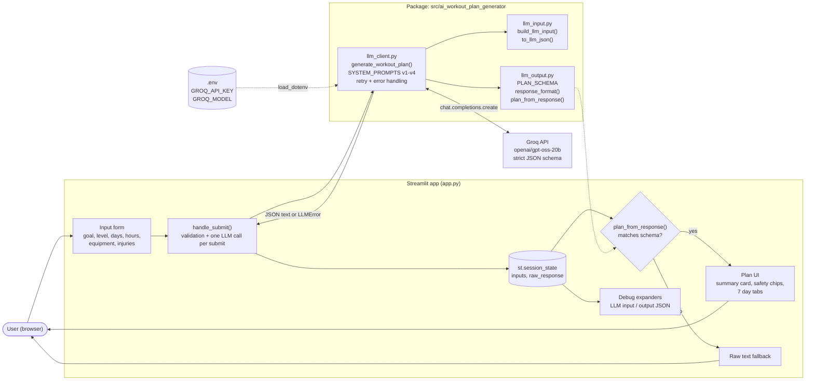
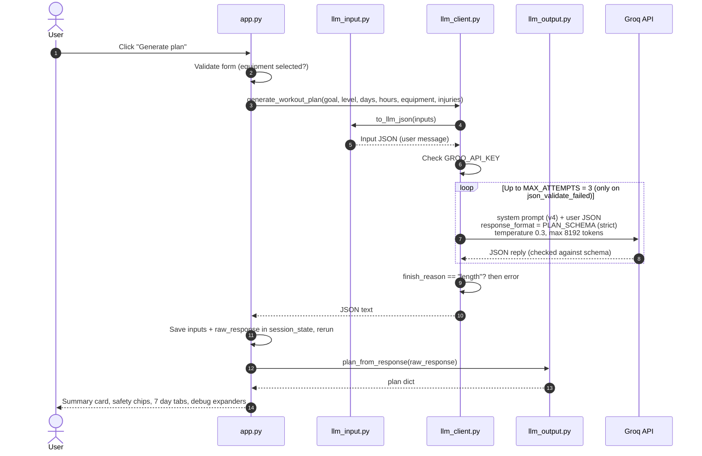
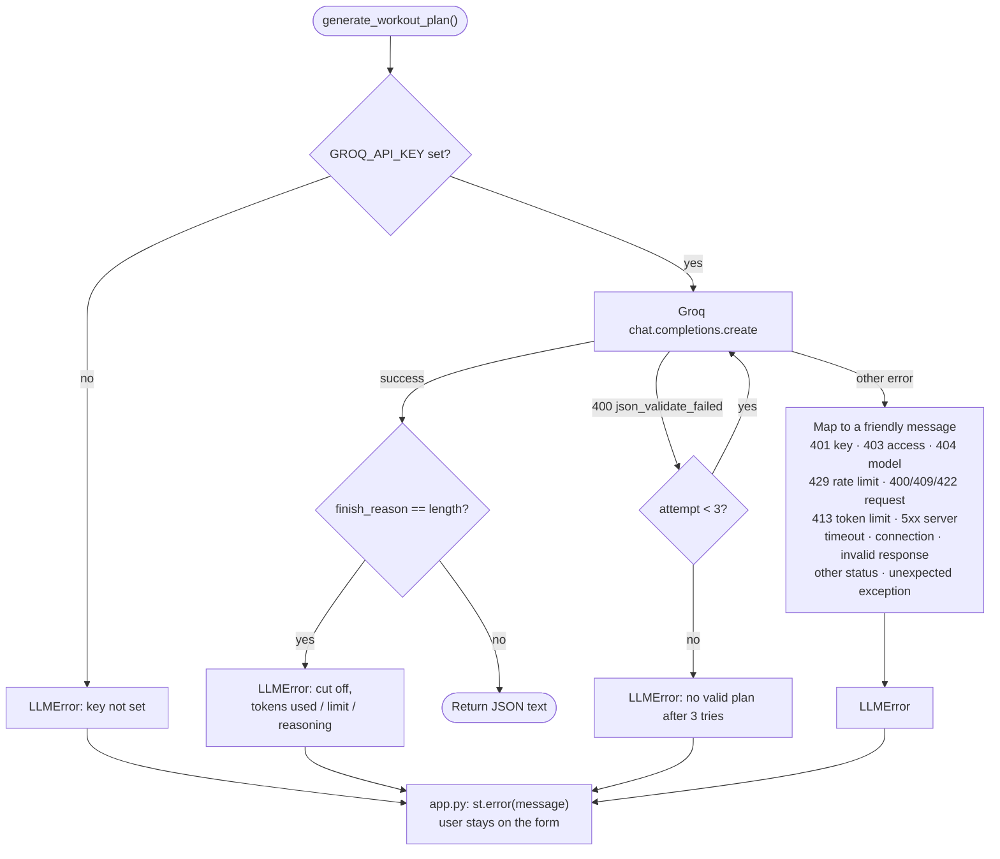
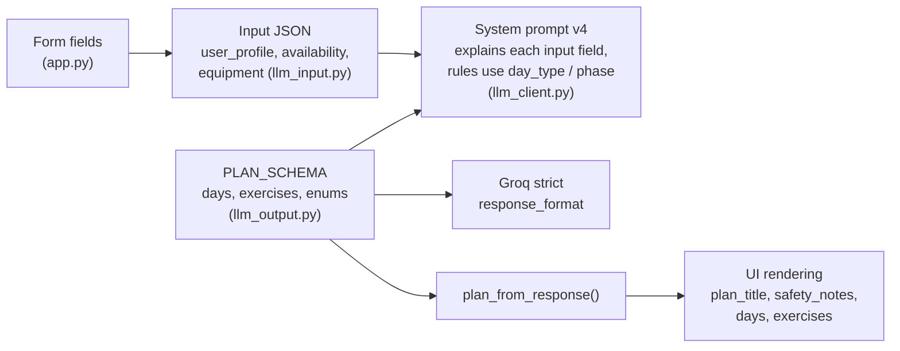
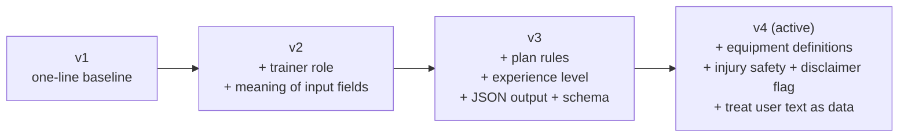

# Architecture

AI Workout Plan Generator is a Streamlit app. The user fills in a form, and the app sends
the answers as structured JSON to an LLM on Groq. The reply must match a JSON schema, and
the app renders it as a weekly plan.

## 1. Components

| Module | Responsibility |
|---|---|
| [app.py](app.py) | Page layout, form, validation, session state, rendering the plan (with HTML escaping), debug expanders |
| [llm_input.py](src/ai_workout_plan_generator/llm_input.py) | Turns form answers into the input JSON the model receives (normalises equipment, empty injuries → `null`) |
| [llm_client.py](src/ai_workout_plan_generator/llm_client.py) | System prompts, Groq call, settings (tokens, temperature, retries), turning every failure into `LLMError` |
| [llm_output.py](src/ai_workout_plan_generator/llm_output.py) | Output schema shared by Groq, the prompt and the UI; schema check before rendering; sample plan |

## 2. Request flow (successful submit)

Streamlit reruns the whole script on every click (tabs, expanders). The LLM is called only
in `handle_submit`, and the reply is cached in `st.session_state`, so reruns never call the API
again.

## 3. Error handling

Every failure inside `generate_workout_plan` becomes an `LLMError` with a message safe to show
users. `app.py` shows it under the form and keeps the user on the form.

## 4. Data contract

The same field names are used in four places, so they must change together:

**Input (sent to the model):** `schema_version`, `request_type`, `user_profile` (goal, level,
injuries or `null`), `availability` (days per week, rest days, session minutes), `equipment`
(available list, `bodyweight_only`).

**Output (returned by the model):** `schema_version`, `plan_title`, `summary`, `safety_notes[]`,
`has_physical_limitation` (the model's judgement of the injuries text; the app shows its fixed
disclaimer only when true), and `days[]` (7 items: `day_number`, `day_type` = workout / rest / active_recovery, `title`, `focus`,
`duration_minutes`, `exercises[]` with `name`, `phase` = warmup / main / cooldown, `sets`, `reps`,
`rest_seconds`, `notes`).

## 5. System prompt versions

Kept side by side in `SYSTEM_PROMPTS`; `ACTIVE_PROMPT` picks the one in use.

## 6. Key settings

| Setting | Where | Value | Why |
|---|---|---|---|
| Model | `.env` `GROQ_MODEL` / `DEFAULT_MODEL` | `openai/gpt-oss-20b` | Supports strict structured output on Groq |
| `MAX_COMPLETION_TOKENS` | llm_client.py | 8192 | Groq's 2048 default cut off replies; reasoning uses part of the budget |
| `TEMPERATURE` | llm_client.py | 0.3 | Fewer random JSON slips, some variety between plans |
| `MAX_ATTEMPTS` | llm_client.py | 3 | Retries only `json_validate_failed` |
| `response_format` | llm_output.py | strict JSON schema | Groq rejects replies that don't match `PLAN_SCHEMA` |

## 7. Safety and security

- **Prompt injection:** the injuries text is user-typed and goes to the model. v4 tells the model
  to treat it as data, and strict output means the reply must still be a plan.
- **HTML injection:** the plan is rendered with `unsafe_allow_html=True`, so every value from the
  LLM goes through `escape()`.
- **Secrets:** the API key lives only in `.env` (gitignored) and is never shown in error messages.
- **Medical safety:** v4 swaps risky exercises, records each adaptation in `safety_notes`, and
  advises seeing a doctor or physiotherapist for serious limitations.
- **Debug expanders** show the user's input and the raw reply. Hide them before sharing the app
  with real users.
